# PassX — Zero-Knowledge Encrypted Password Vault

<div align="center">


[](https://www.typescriptlang.org/)
[](https://reactrouter.com/)
[](https://developer.mozilla.org/en-US/docs/Web/API/Web_Crypto_API)
[](https://firebase.google.com/)
[](https://tailwindcss.com/)
[](#security-architecture)

**A next-generation, client-side zero-knowledge password manager and security audit dashboard.**  
*Your master password and unencrypted credentials never leave your browser.*

</div>

---

## 🔒 Zero-Knowledge Guarantee

PassX operates under a **Strict Zero-Knowledge Architecture**:

* **Client-Side Encryption:** All credentials (`service`, `username`, `password`, `notes`) are encrypted client-side using hardware-accelerated **AES-256-GCM** before touching any network connection or database.
* **OWASP Key Derivation:** Master keys are derived using **PBKDF2-HMAC-SHA256 with 600,000 iterations** combined with a unique, cryptographically random 16-byte user salt.
* **Non-Extractable Keys in RAM:** Derived keys are stored as non-extractable `CryptoKey` instances in browser memory only. They cannot be extracted by third-party browser extensions or XSS injection, and are never saved to `localStorage`, `sessionStorage`, or cookies.
* **Zero Metadata Leakage:** Field names, usernames, and service identifiers are packed inside the encrypted ciphertext payload—Firestore only stores random-looking base64 strings and 12-byte initialization vectors (IVs).

---

## ✨ Features

- 🛡️ **Zero-Knowledge Vault:** End-to-end client-side encryption powered by native Web Crypto API (`SubtleCrypto`).
- 🎲 **High-Entropy Password Generator:** Cryptographically secure generator with unbiased rejection sampling, customizable length, symbol toggles, and ambiguous character filtering (`l`, `1`, `I`, `0`, `O`).
- 📊 **Vault Health & Entropy Audit:** Real-time analysis calculating Shannon/pool entropy in bits, detecting reused passwords, and grading credentials from "Weak" to "Military-Grade".
- ⏱️ **Auto-Lock Session Timer:** Resilient 15-minute wall-clock countdown that purges keys and in-memory credentials upon expiration.
- 📋 **Automated Clipboard Sanitizer:** Secure copy with automatic 30-second clipboard memory wipe and manual sanitization buttons.
- 🔍 **Instant Search & Categorization:** Filter passwords by tags (`Logins`, `Banking`, `Work`, `Personal`) with instant client-side search.
- 🎨 **Modern Cyber Aesthetic:** Built with Tailwind CSS v4, dynamic glassmorphism cards, micro-animations, and responsive layouts.
- 🐳 **Production Docker Support:** Multi-stage Docker build ready for enterprise cloud deployment (Cloud Run, ECS, Fly.io, Railway).

---

## 🏛️ Security Architecture

```mermaid
sequenceDiagram
    autonumber
    actor User as User Browser
    participant Engine as Web Crypto Engine
    participant RAM as In-Memory State
    participant Cloud as Firebase Firestore

    User->>Engine: Enter Master Password + User Salt
    Note over Engine: PBKDF2 (SHA-256, 600,000 rounds)
    Engine->>RAM: Store Derived Key (extractable: false)
    
    rect rgb(20, 25, 35)
        Note over User,RAM: Adding or Updating Vault Item
        User->>Engine: Payload (Service, Username, Password, Notes)
        Engine->>Engine: Generate Random 12-byte IV + AES-256-GCM Encrypt
        Engine->>Cloud: Send { ciphertext, iv, userId } (Zero Plaintext)
    end

    rect rgb(20, 25, 35)
        Note over Cloud,RAM: Reading Vault
        Cloud-->>Engine: Fetch Encrypted Docs
        Engine->>Engine: AES-256-GCM Decrypt using RAM Key
        Engine-->>User: Render Decrypted Credentials
    end

    Note over User,RAM: Session Expiry (15m) or Logout -> RAM Purged
```



---

## 🚀 Getting Started

### Prerequisites

- [Node.js](https://nodejs.org/) (v20.x or v22.x recommended)
- A [Firebase](https://firebase.google.com/) project with **Authentication (Email/Password)** and **Cloud Firestore** enabled.

### 1. Clone & Install Dependencies

```bash
git clone https://github.com/AnshulVishwa/PassX.git
cd PassX
npm install
```

### 2. Configure Environment Variables

Copy `.env.example` to `.env`:

```bash
cp .env.example .env
```

Open `.env` and fill in your Firebase Web App configuration from the [Firebase Console](https://console.firebase.google.com/):

```env
VITE_FIREBASE_API_KEY="AIzaSy..."
VITE_FIREBASE_AUTH_DOMAIN="your-app.firebaseapp.com"
VITE_FIREBASE_PROJECT_ID="your-project-id"
VITE_FIREBASE_STORAGE_BUCKET="your-app.firebasestorage.app"
VITE_FIREBASE_MESSAGING_SENDER_ID="123456789012"
VITE_FIREBASE_APP_ID="1:123456789012:web:abcdef..."
VITE_FIREBASE_MEASUREMENT_ID="G-XXXXXXXXXX"
```

### 3. Deploy Firestore Security Rules

Publish the zero-trust security rules located in [`firestore.rules`](./firestore.rules) to your Firebase Console under **Firestore Database → Rules**:

```bash
# Using Firebase CLI
firebase deploy --only firestore:rules
```

*Or paste the contents of [`firestore.rules`](./firestore.rules) directly into the Firebase web console.*

### 4. Start Development Server

```bash
npm run dev
```

The application will be running locally at `http://localhost:5173`.

---

## 🛠️ Scripts & Quality Verification

| Command | Description |
| :--- | :--- |
| `npm run dev` | Starts development server with HMR. |
| `npm run typecheck` | Validates TypeScript contracts and React Router routes. |
| `npm run build` | Generates optimized production client and SSR bundles. |
| `npm run start` | Serves the production build locally. |
| `npm audit` | Scans dependencies for security vulnerabilities (0 vulnerabilities). |

---

## 🐳 Docker Deployment

To build and run PassX in a sandboxed, production-ready container:

```bash
# 1. Build the Docker image
docker build -t passx-vault .

# 2. Run container on port 3000
docker run -p 3000:3000 --env-file .env passx-vault
```

The app will be accessible at `http://localhost:3000`.

---

## 🔐 Cryptographic Specifications

| Component | Standard / Algorithm | Details |
| :--- | :--- | :--- |
| **Key Derivation (KDF)** | PBKDF2-HMAC-SHA256 | 600,000 rounds with 128-bit random salt |
| **Symmetric Cipher** | AES-256-GCM | Authenticated 256-bit encryption with 96-bit (12-byte) IV per record |
| **PRNG** | `Crypto.getRandomValues()` | Cryptographic rejection sampling (zero modulo bias) |
| **Key Extraction** | `extractable: false` | Native Web Crypto API preventing heap extraction |
| **Database Access** | Zero-Trust Firestore Rules | Strict UID ownership enforcement (`request.auth.uid == userId`) |

---

## 📄 License

This project is open-source and available under the [MIT License](LICENSE).
